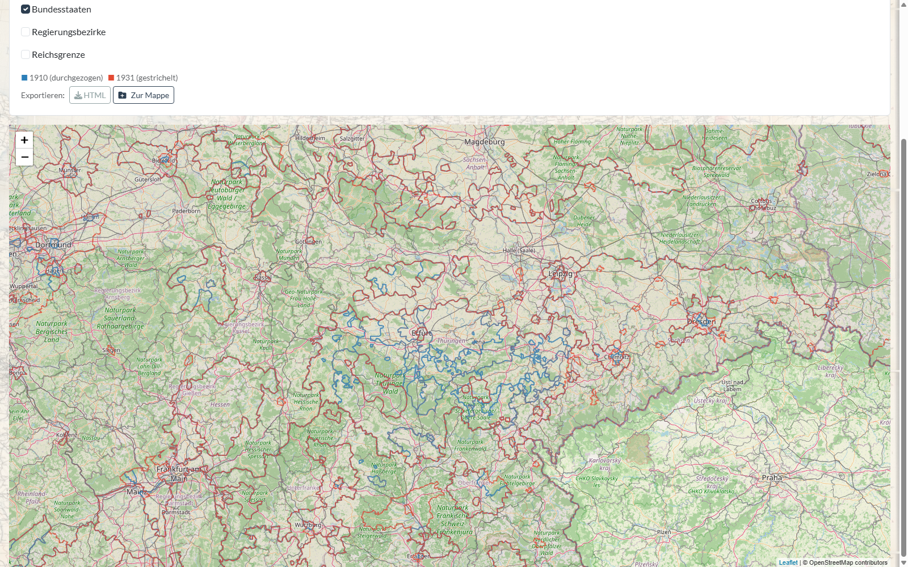
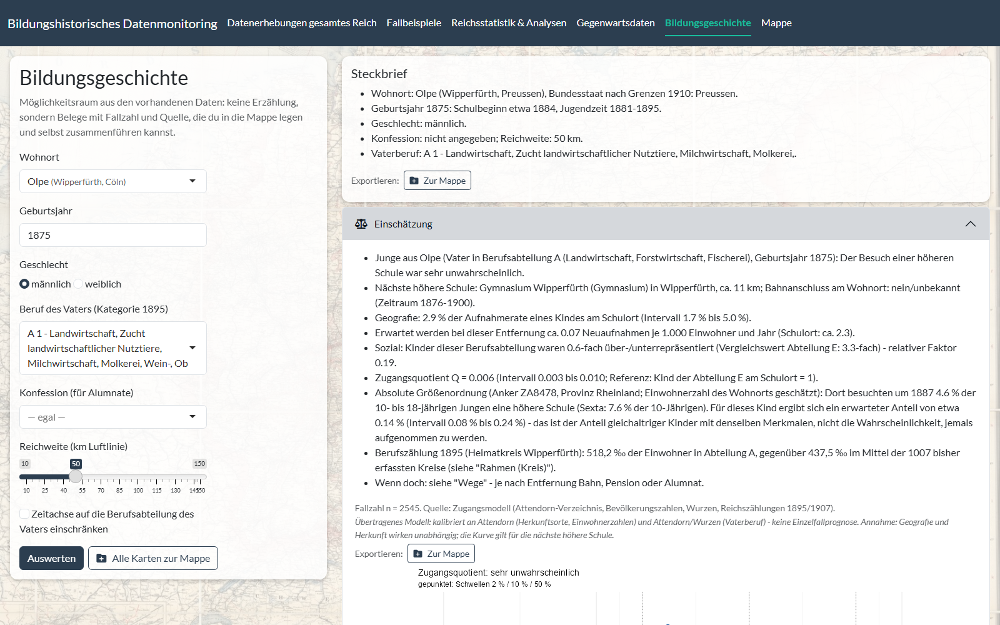
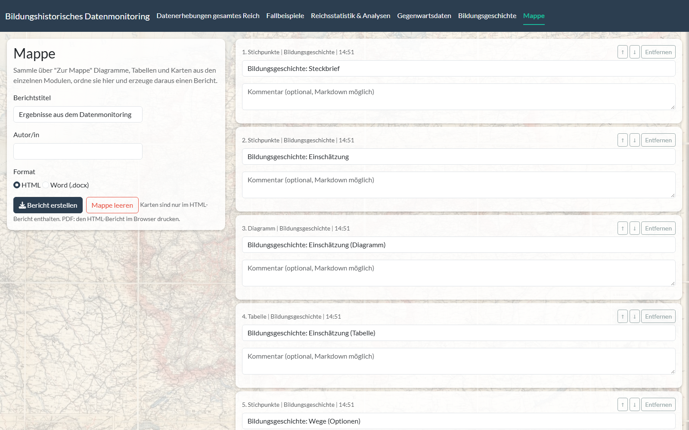
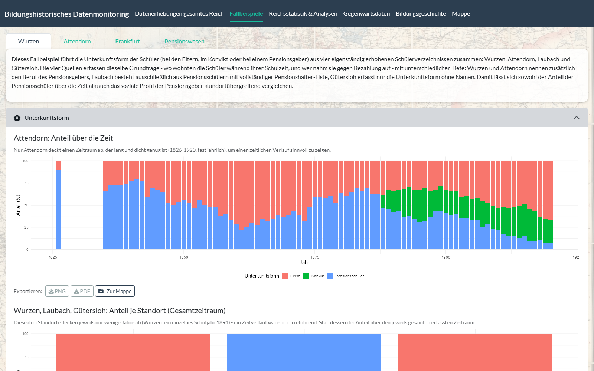
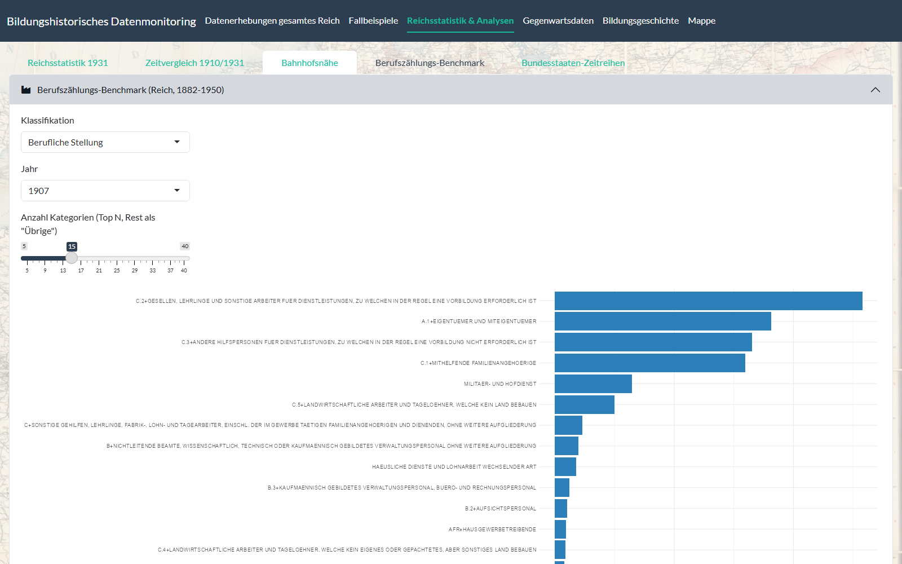
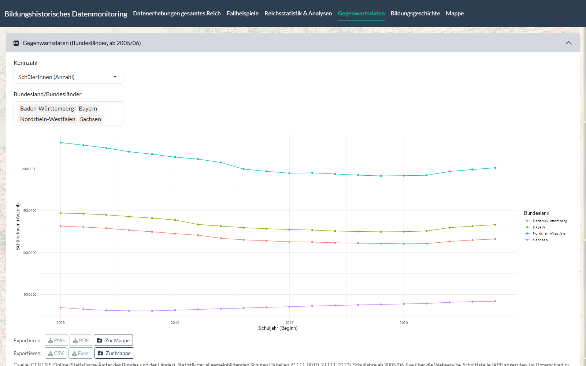
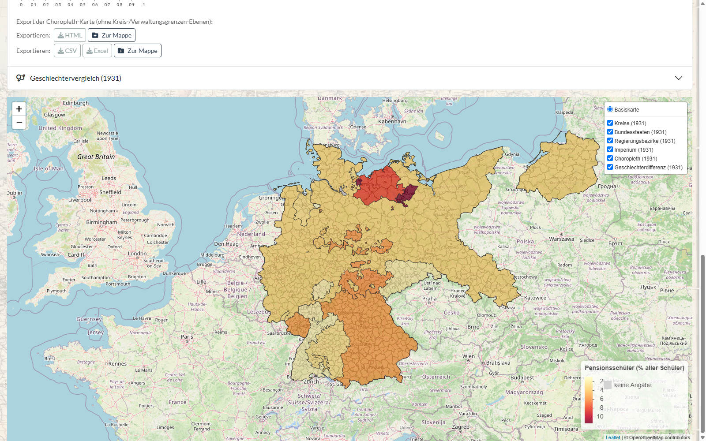
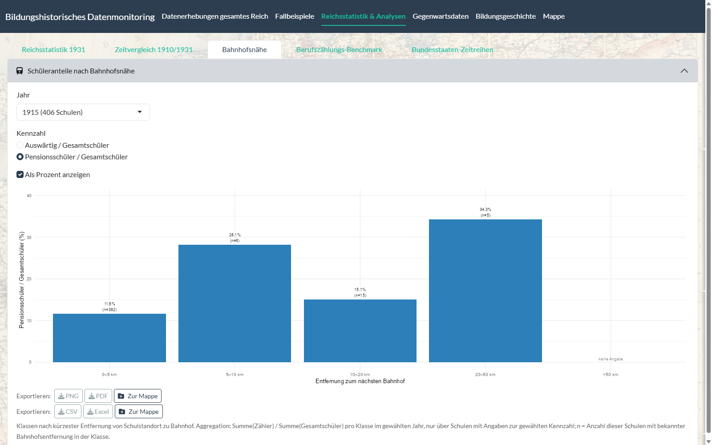
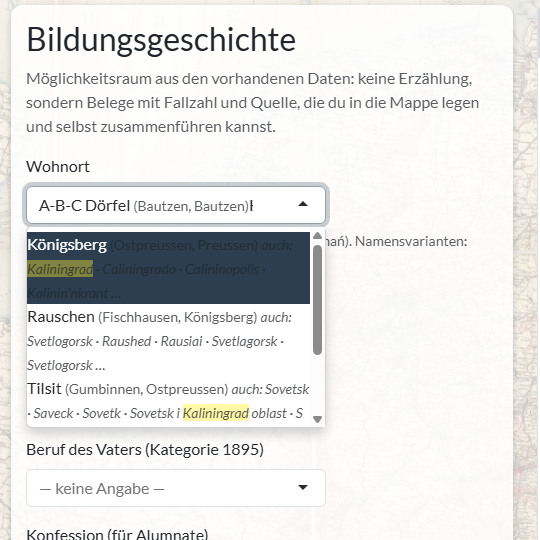

# Bildungshistorisches Datenmonitoring

**Ein Werkzeug zur Exploration, Analyse und Visualisierung bildungs- und sozialhistorischer Daten (Schwerpunkt Deutsches Kaiserreich, 1871–1918).**

Dieses Repository dokumentiert das Forschungswerkzeug *Bildungshistorisches Datenmonitoring*. Es ist als **öffentliche Projektbeschreibung (Showcase)** angelegt: Es enthält die Dokumentation und ausgewählte Ansichten, **nicht** aber den vollständigen Quellcode und **keine** Forschungsdaten (siehe [Daten und Datenschutz](#daten-und-datenschutz)).

> **Status:** in Entwicklung · Autor: Dr. Dennis Mathie · Kontakt: mathied@hsu-hh.de

---

## Überblick

Das *Bildungshistorische Datenmonitoring* stellt ein modular aufgebautes Werkzeug für die strukturierte Erfassung, Analyse und Visualisierung serieller und nicht-serieller Daten zur Bildungs- und Sozialgeschichte bereit. Der zeitliche Schwerpunkt liegt auf dem Deutschen Kaiserreich (1871–1918), ist aber nicht grundsätzlich darauf beschränkt. Das Werkzeug bietet zwei Zugänge:

1. **Serielle Daten** auf Grundlage großflächiger Erhebungen – aus der wissenschaftlichen Literatur (u. a. dem *Datenhandbuch zur deutschen Bildungsgeschichte*) ebenso wie aus zeitgenössischen Quellen (Schul- bzw. Jahresprogramme, Berufsstatistik).
2. **Fallstudien** mit jeweils spezifischen Ansatzpunkten für Analyse und Darstellung.

Das Werkzeug ist im Rahmen des Projekts *„Schülerpensionen und Schülerverbindungen“* (Prof. Dr. Carola Groppe / Dr. Dennis Mathie) an der Helmut-Schmidt-Universität / Universität der Bundeswehr Hamburg entstanden.

## Methoden

- **Strukturierte Quellenerschließung:** Zusammenführung heterogener Quellen (serielle Bildungs- und Sozialstatistik sowie archivalische Einzelquellen) in einer konsistenten, reproduzierbaren Datenbasis (bereinigte Spaltenschemata, Export in ein einheitliches Format).
- **Historische Geodaten / Georeferenzierung:** Verortung von Schülerdaten auf historischen Stadtplänen (Beispiel Wurzen: Stadtplan von 1897 und Adressbuch von 1895 aus dem Stadtarchiv) sowie auf historischen Verwaltungsgrenzen (Kreise des Deutschen Reiches, 1910/1931).
- **Normierte Ortsregister (Gazetteer):** Aufbau eines Kreis-Gazetteers mit normalisierten Schlüsseln zur verlässlichen Zuordnung historischer Verwaltungseinheiten. Ein Ortsverzeichnis mit rund 185.000 historischen Orten ist über die Lage mit [GeoNames](https://www.geonames.org) verknüpft: Heutige Namen und Exonyme führen so zum historischen Ort (Wrocław → Breslau, Kaliningrad → Königsberg), Herkunftsorte im Ausland lassen sich ebenfalls zuordnen.
- **OCR-gestützte Erschließung:** halbautomatische Erfassung gedruckter Tabellen aus digitalisierten Quellen.
- **Interaktive Darstellung:** Karten, Diagramme und tabellarische Ranglisten; Export einzelner Darstellungen.
- **Verknüpfung mit der Berufsstatistik:** Berufs- und Gewerbezählung 1895 auf Kreisebene (eigene Transkription), verknüpft mit den Berufsangaben der Väter in den Schülerverzeichnissen.
- **Transparente Modellierung:** ein an den Fallstudien kalibriertes Zugangsmodell, das für eine gedachte Person Belege mit Fallzahl und Quelle zusammenstellt, statt eine Einzelfallprognose zu geben.

Technisch basiert das Werkzeug auf **R** und **Shiny** (u. a. `sf`, `leaflet`, `terra`/`raster`, `magick`, `tesseract`, `arrow`) und ist modular aufgebaut, sodass es sich leicht erweitern lässt.

## Funktionsumfang (Stand: Oktober 2026)

| Bereich | Inhalt |
|---|---|
| **Datenerhebungen gesamtes Reich** | Geo-Visualisierung mit historischen Karten, Kreisen und Verwaltungsebenen, Wohnplätzen, Bahnhöfen, höheren Schulen (gefiltert nach Schultyp, Trägerschaft, Konfession, Jahr), Alumnaten und Choroplethen zu Schüleranteilen; Datenbearbeitung; **eigene Datensätze** mit beliebigem Spaltenschema hochladen, Ortsnamen (auch heutige Namen und Orte im Ausland) gegen das Gazetteer abgleichen und als Karte darstellen |
| **Fallbeispiele** | Wurzen, Attendorn, Frankfurt am Main sowie ein standortübergreifender Vergleich des Pensionswesens (Unterkunftsform, Pensionsgeber) |
| **Reichsstatistik & Analysen** | Reichserhebung 1931 (Kreise, Länder, Geschlechtervergleich), Zeitvergleich der Verwaltungsgrenzen 1910/1931, Schüleranteile nach Bahnhofsnähe, Benchmark der Berufszählungen 1882–1950, Zeitreihen der Bundesstaaten |
| **Gegenwartsdaten** | Schulstatistik der Bundesländer ab 2005/06, live über die GENESIS-Schnittstelle der Statistischen Ämter |
| **Bildungsgeschichte** | Möglichkeitsraum für eine gedachte Person (Wohnort – auch über den heutigen Ortsnamen suchbar –, Geburtsjahr, Geschlecht, Beruf des Vaters): Einschätzung, Wege, Zeitachse, Rahmen auf Ebene von Bundesstaat und Kreis sowie Belege aus den Fallstudien – jeweils mit Fallzahl und Quelle |
| **Mappe** | Diagramme, Tabellen und Karten aus allen Modulen sammeln, kommentieren, ordnen und als Bericht (HTML oder Word) ausgeben |

Optional lässt sich ein Sprachmodell anbinden (anbieteroffen; standardmäßig ausgeschaltet). Es schlägt Zuordnungen für nicht erkannte historische Ortsnamen vor und formuliert eine ausdrücklich als solche gekennzeichnete KI-Einschätzung zu Karten und Belegen. Zugangsschlüssel werden ausschließlich lokal hinterlegt.

## Fallstudien (Auswahl)

Wurzen, Attendorn, Laubach, Gütersloh und Frankfurt am Main – u. a. zur Unterkunftsform von Schülern (Elternhaus, Konvikt, Schülerpension) und zum sozialen Profil der Pensionsgeber.

## Ansichten

*Geo-Visualisierung: höhere Schulen (gruppiert) über einer historischen Reichskarte mit Bundesstaaten; links das Ebenenmenü, rechts die Ebenensteuerung der Karte.*

*Verortung höherer Schulen auf einer historischen topografischen Karte mit zuschaltbaren Ebenen (Kreise, Eisenbahnlinien, Bundesstaaten).*

*Zeitvergleich der Verwaltungsgrenzen: Kreise 1910 (blau, durchgezogen) und 1931 (rot, gestrichelt) übereinandergelegt – hier Thüringen, das 1920 aus den thüringischen Kleinstaaten gebildet wurde.*

*Bildungsgeschichte: Für eine gedachte Person (hier: Junge aus Olpe, Rheinprovinz, geboren 1875, Vater in der Landwirtschaft) stellt das Modul Belege zusammen – nächste höhere Schule, geografischer und sozialer Faktor, Berufsstruktur des Heimatkreises 1895 –, jeweils mit Fallzahl, Quelle und Unsicherheitsintervall.*

*Mappe: Elemente aus allen Modulen werden gesammelt, kommentiert und als HTML- oder Word-Bericht ausgegeben.*

*Fallbeispiel Pensionswesen: Anteil der Schüler bei den Eltern, im Konvikt und in Pension am Gymnasium Attendorn 1826–1920 (aggregiert).*

*Berufszählungs-Benchmark: Verteilung der Erwerbstätigen nach beruflicher Stellung, hier Berufszählung 1907.*

*Gegenwartsdaten: Schülerinnen und Schüler allgemeinbildender Schulen nach Bundesländern, abgerufen über die GENESIS-Schnittstelle.*

*Reichserhebung 1931: Anteil der auswärtigen Schüler in Familienunterkunft (Pension) an allen Schülern der öffentlichen Knabenanstalten, je Land der Erhebung (Hamburg schlüsselt die Auswärtigen nicht auf: keine Angabe).*

*Bahnhofsnähe: Anteil der Pensionsschüler 1915 nach Entfernung des Schulorts zum nächsten Bahnhof – berechnet nur über Schulen mit Angaben, Fallzahl je Klasse in Klammern.*

*Ortssuche mit heutigen Namen: Die Eingabe „Kaliningrad“ findet Königsberg sowie Rauschen (Swetlogorsk) und Tilsit (Sowetsk); die Namensvarianten stammen aus GeoNames.*

Darstellungen auf Einzelpersonenebene (etwa Netzwerke einzelner Schüler, Namen oder Adressen aus den Schülerverzeichnissen) sind aus Datenschutz- und Urheberschaftsgründen bewusst **nicht** enthalten.

## Datenquellen Dritter

Ortsnamen-Varianten und Orte im Ausland: [GeoNames](https://www.geonames.org), lizenziert unter [CC BY 4.0](https://creativecommons.org/licenses/by/4.0/). Kartenhintergründe: © [OpenStreetMap](https://www.openstreetmap.org/copyright)-Mitwirkende.

## Daten und Datenschutz

Die zugrunde liegenden Forschungsdaten (u. a. eigenständig erhobene Schülerverzeichnisse) sind **bewusst nicht Teil dieses Repositoriums** – aus Gründen des Datenschutzes, des Umfangs sowie laufender, noch unveröffentlichter Auswertungen. Eine zitierfähige, **zugriffsbeschränkte Archivversion** des Quellcodes ist über Zenodo hinterlegt (siehe [Zitation](#zitation)); Einsicht in Code oder Daten ist **auf Anfrage** möglich.

## Zitation

Bitte zitieren Sie die über Zenodo archivierte Version (siehe [`CITATION.cff`](CITATION.cff)):

> Mathie, Dennis: *Bildungshistorisches Datenmonitoring. Ein Werkzeug zur Exploration, Analyse und Visualisierung bildungs- und sozialhistorischer Daten* (Forschungssoftware). Version 0.1.0, 2026. DOI: [10.5281/zenodo.23297658](https://doi.org/10.5281/zenodo.23297658).

## Lizenz

Alle Rechte vorbehalten. Einsicht zur Begutachtung ist gestattet; jede Nachnutzung, Vervielfältigung oder Verbreitung bedarf der vorherigen schriftlichen Zustimmung des Autors. Siehe [`LICENSE`](LICENSE).

## Kontakt

Dr. Dennis Mathie · mathied@hsu-hh.de · ORCID [0009-0005-7520-3253](https://orcid.org/0009-0005-7520-3253) · [hsu-hh.de/paehis/dennis-mathie](https://www.hsu-hh.de/paehis/dennis-mathie)
