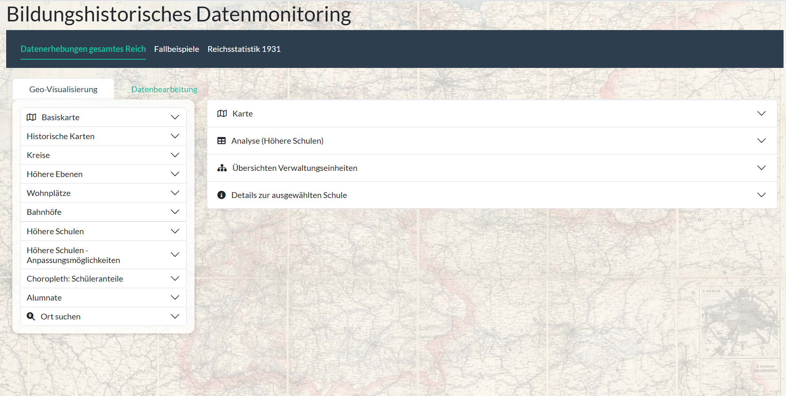
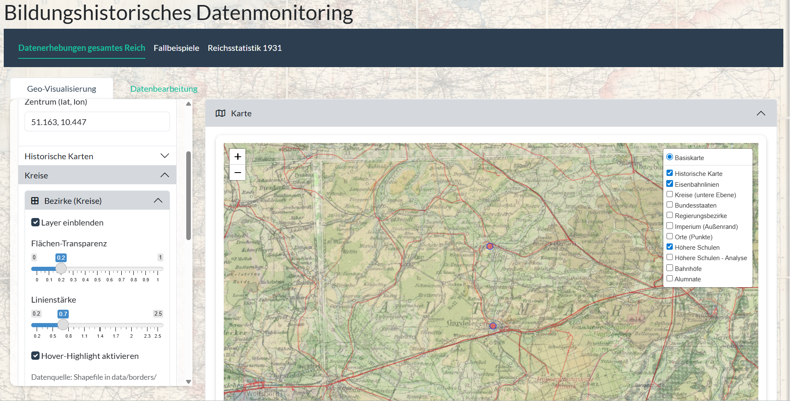

# Bildungshistorisches Datenmonitoring

**Ein Werkzeug zur Exploration, Analyse und Visualisierung bildungs- und sozialhistorischer Daten (Schwerpunkt Deutsches Kaiserreich, 1871–1918).**

Dieses Repository dokumentiert das Forschungswerkzeug *Bildungshistorisches Datenmonitoring*. Es ist als **öffentliche Projektbeschreibung (Showcase)** angelegt: Es enthält die Dokumentation und ausgewählte Ansichten, **nicht** aber den vollständigen Quellcode und **keine** Forschungsdaten (siehe [Daten und Datenschutz](#daten-und-datenschutz)).

> **Status:** in Entwicklung · Autor: Dr. Dennis Mathie · Kontakt: mathied@hsu-hh.de

---

## Überblick

Das *Bildungshistorische Datenmonitoring* stellt ein modular aufgebautes Werkzeug für die strukturierte Erfassung, Analyse und Visualisierung serieller und nicht-serieller Daten zur Bildungs- und Sozialgeschichte bereit. Der zeitliche Schwerpunkt liegt auf dem Deutschen Kaiserreich (1871–1918), ist aber nicht grundsätzlich darauf beschränkt. Das Werkzeug bietet zwei Zugänge:

1. **Serielle Daten** auf Grundlage großflächiger Erhebungen – aus der wissenschaftlichen Literatur (u. a. dem *Datenhandbuch zur deutschen Bildungsgeschichte*) ebenso wie aus zeitgenössischen Quellen (Schul- bzw. Jahresprogramme, Berufsstatistik).
2. **Fallstudien** mit jeweils spezifischen Ansatzpunkten für Analyse und Darstellung.

Das Werkzeug ist im Rahmen des Projekts *„Schülerpensionen und Schülerverbindungen“* (Prof. Dr. Carola Groppe / Dr. Dennis Mathie) an der Helmut-Schmidt-Universität / Universität der Bundeswehr Hamburg entstanden.

## Methoden

- **Strukturierte Quellenerschließung:** Zusammenführung heterogener Quellen (serielle Bildungs- und Sozialstatistik sowie archivalische Einzelquellen) in einer konsistenten, reproduzierbaren Datenbasis (bereinigte Spaltenschemata, Export in ein einheitliches Format).
- **Historische Geodaten / Georeferenzierung:** Verortung von Schülerdaten auf historischen Stadtplänen (Beispiel Wurzen: Stadtplan von 1897 und Adressbuch von 1895 aus dem Stadtarchiv) sowie auf historischen Verwaltungsgrenzen (Kreise des Deutschen Reiches, 1910/1931).
- **Normierte Ortsregister (Gazetteer):** Aufbau eines Kreis-Gazetteers mit normalisierten Schlüsseln zur verlässlichen Zuordnung historischer Verwaltungseinheiten.
- **OCR-gestützte Erschließung:** halbautomatische Erfassung gedruckter Tabellen aus digitalisierten Quellen.
- **Interaktive Darstellung:** Karten, Diagramme und tabellarische Ranglisten; Export einzelner Darstellungen.

Technisch basiert das Werkzeug auf **R** und **Shiny** (u. a. `sf`, `leaflet`, `terra`/`raster`, `magick`, `tesseract`, `arrow`) und ist modular aufgebaut, sodass es sich leicht erweitern lässt.

## Fallstudien (Auswahl)

Wurzen, Attendorn, Laubach, Gütersloh und Frankfurt am Main – u. a. zur Unterkunftsform von Schülern (Elternhaus, Konvikt, Schülerpension) und zum sozialen Profil der Pensionsgeber.

## Ansichten

*Startansicht: Ebenen- und Analysemenü der Geo-Visualisierung (Basiskarte, historische Karten, Kreise, höhere Schulen, Choropleth u. a.).*

*Verortung höherer Schulen auf einer historischen topografischen Karte mit zuschaltbaren Ebenen (Kreise, Eisenbahnlinien, Bundesstaaten).*

Weitere Ansichten befinden sich im Ordner [`docs/`](docs/). Darstellungen auf Einzelpersonenebene (etwa Netzwerke einzelner Schüler) sind aus Datenschutz- und Urheberschaftsgründen bewusst **nicht** enthalten.

## Daten und Datenschutz

Die zugrunde liegenden Forschungsdaten (u. a. eigenständig erhobene Schülerverzeichnisse) sind **bewusst nicht Teil dieses Repositoriums** – aus Gründen des Datenschutzes, des Umfangs sowie laufender, noch unveröffentlichter Auswertungen. Eine zitierfähige, **zugriffsbeschränkte Archivversion** des Quellcodes ist über Zenodo hinterlegt (siehe [Zitation](#zitation)); Einsicht in Code oder Daten ist **auf Anfrage** möglich.

## Zitation

Bitte zitieren Sie die über Zenodo archivierte Version (siehe [`CITATION.cff`](CITATION.cff)):

> Mathie, Dennis: *Bildungshistorisches Datenmonitoring. Ein Werkzeug zur Exploration, Analyse und Visualisierung bildungs- und sozialhistorischer Daten* (Forschungssoftware). Version 0.1.0, 2026. DOI: [10.5281/zenodo.23297658](https://doi.org/10.5281/zenodo.23297658).

## Lizenz

Alle Rechte vorbehalten. Einsicht zur Begutachtung ist gestattet; jede Nachnutzung, Vervielfältigung oder Verbreitung bedarf der vorherigen schriftlichen Zustimmung des Autors. Siehe [`LICENSE`](LICENSE).

## Kontakt

Dr. Dennis Mathie · mathied@hsu-hh.de · ORCID [0009-0005-7520-3253](https://orcid.org/0009-0005-7520-3253) · [hsu-hh.de/paehis/dennis-mathie](https://www.hsu-hh.de/paehis/dennis-mathie)
